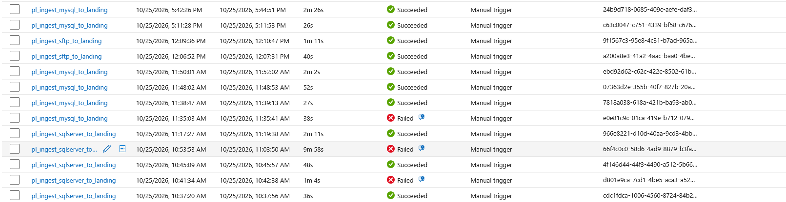
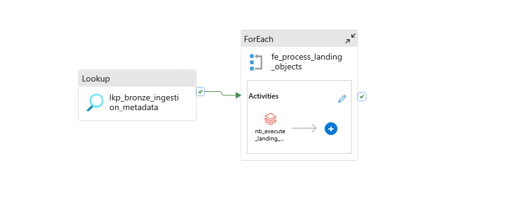
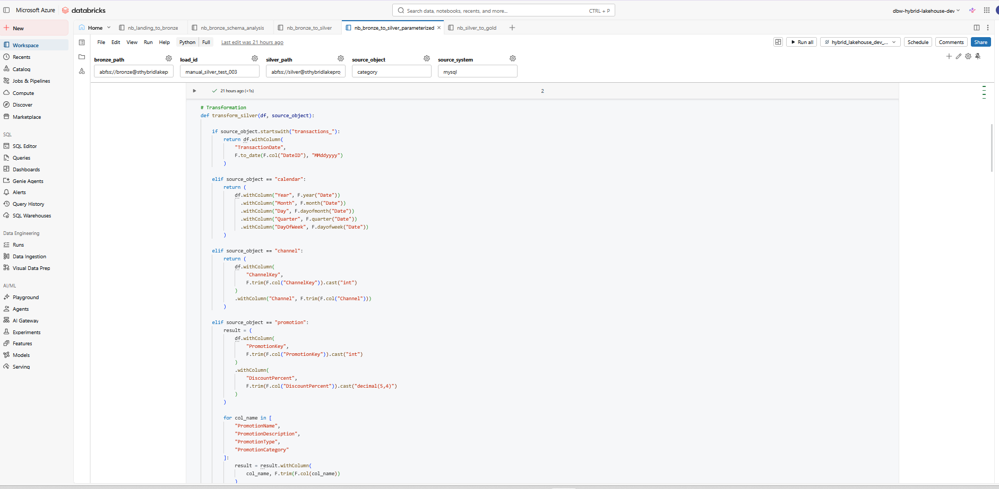
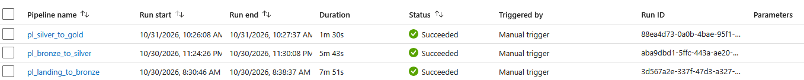
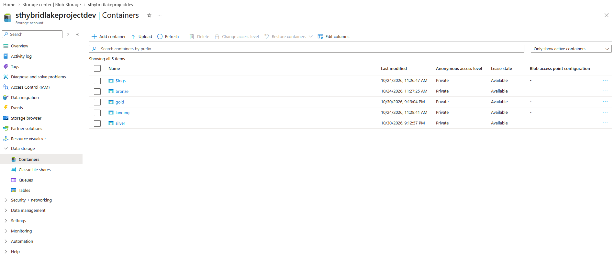
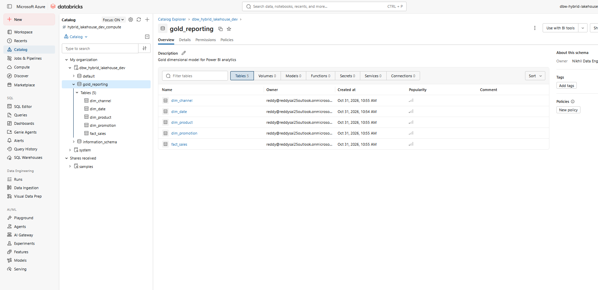

# Hybrid Azure Lakehouse Data Platform

### End-to-End Azure Data Engineering | Metadata-Driven ETL | Medallion Architecture | Power BI

An end-to-end data engineering project that integrates data from on-premises SQL Server, MySQL, and SFTP into an Azure Lakehouse using Azure Data Factory, Azure Data Lake Storage Gen2, Azure Databricks, PySpark, Delta Lake, and Power BI.

The platform implements a **Landing → Bronze → Silver → Gold** architecture, supporting metadata-driven ingestion, reusable transformations, data-quality validation, dimensional modeling, and business intelligence.

## Architecture

**Source Systems → Azure Data Factory → ADLS Landing → Databricks Bronze → Databricks Silver → Gold Star Schema → Power BI**

| Layer | Responsibility |
|---|---|
| Sources | On-premises SQL Server, MySQL and SFTP |
| Ingestion | Metadata-driven Azure Data Factory pipelines |
| Landing | Source extracts stored in ADLS Gen2 |
| Bronze | Source-preserving Delta datasets with ingestion lineage |
| Silver | Standardization, cleansing, datatype conversion and validation |
| Gold | Sales-oriented star schema with fact and dimension tables |
| Reporting | Power BI semantic model using Databricks SQL Warehouse |

## Technology Stack

**Cloud:** Microsoft Azure, ADLS Gen2

**Orchestration:** Azure Data Factory, Self-hosted Integration Runtime

**Data Processing:** Azure Databricks, Python, PySpark, Spark SQL

**Storage:** Delta Lake, Parquet

**Databases:** SQL Server, MySQL

**Data Modeling:** Medallion Architecture, Star Schema, Fact and Dimension Modeling

**Analytics:** Power BI, DAX

**DevOps:** Azure DevOps Repos, Git, Feature Branches, Pull Requests

## Project Implementation

### 1. Multi-Source Data Ingestion

Designed ADF pipelines to ingest data from three source systems into the Landing Layer.

Used metadata tables in SQL Server to store ingestion configuration and drive pipeline execution.



### 2. Metadata-Driven Pipeline Orchestration

Implemented a reusable ADF orchestration pattern using Lookup, ForEach, dynamic expressions, and parameterized Databricks notebooks.

This minimizes hardcoded pipelines and supports multiple registered source objects through reusable execution logic.



### 3. Bronze and Silver Processing

Processed nine datasets across the three source systems.

The Bronze layer preserves source data in Delta format with ingestion metadata.

The Silver layer implements:

- Data type standardization
- Null and required-field validation
- Dimension business-key uniqueness checks
- Referential-integrity validation
- Object-specific PySpark transformations
- Parameterized notebook execution



### 4. Gold Dimensional Modeling

Designed a sales-oriented star schema containing:

| Table | Record Count |
|---|---:|
| fact_sales | 2,798,589 |
| dim_date | 1,095 |
| dim_product | 2,517 |
| dim_channel | 4 |
| dim_promotion | 28 |

Combined three years of Silver transaction data into `fact_sales`, preserving the original row-level grain.

Enriched product records with category and subcategory attributes.

Validated all four fact-to-dimension relationships with zero unmatched fact rows.

### 5. End-to-End Orchestration

Implemented ADF orchestration for Landing, Bronze, Silver and Gold processing.

All four processing stages were successfully executed and validated during development.



### 6. Storage and Data Governance

Organized data into separate Landing, Bronze, Silver and Gold containers in ADLS Gen2.

Registered Gold Delta datasets as external tables in Unity Catalog to support SQL-based analytics.





### 7. Power BI Integration

Connected Power BI to Databricks SQL Warehouse.

Created an Import-mode semantic model containing the five Gold tables and verified that all 2,798,589 fact rows were queryable.

**Dashboard development:** In progress.

## Validation Results

- 9 Bronze datasets processed
- 9 Silver datasets validated
- 2,802,285 total Bronze-to-Silver records reconciled
- 2,798,589 sales fact records persisted in Gold
- 4 Gold dimensions successfully generated
- 0 unmatched fact-to-dimension relationships
- Successful ADF pipeline orchestration through Gold
- Power BI Import semantic model verified

## Repository Structure

```text
adf/              ADF pipelines, datasets and linked-service definitions
databricks/       PySpark notebooks
sql/              SQL metadata and setup scripts
docs/             Architecture, implementation and troubleshooting
screenshots/      Project execution and architecture evidence
README.md         Project overview
```

## Engineering Decisions and Limitations

- Full-refresh Delta overwrite is used rather than incremental CDC/MERGE processing.
- Transaction rows are preserved because a reliable source-level unique transaction identifier has not been established.
- Invalid records currently cause validation failures rather than being written to a quarantine area.
- Financial metrics preserve source amounts; additional net-sales calculations require confirmed business definitions.
- Infrastructure credentials are not included in this public repository.
- Reproducing the environment requires independent Azure configuration, access permissions and credentials.

## Future Enhancements

- Incremental ingestion and Delta MERGE
- Data-quality audit dashboards and quarantine handling
- Automated monitoring and alerting
- CI/CD deployment hardening
- Interactive Power BI sales analytics dashboard

---

**Project Focus:** Building a metadata-driven, enterprise-style Azure data engineering platform integrating heterogeneous sources, reusable ETL pipelines, Delta Lake transformations, governed analytical tables and Power BI reporting.
